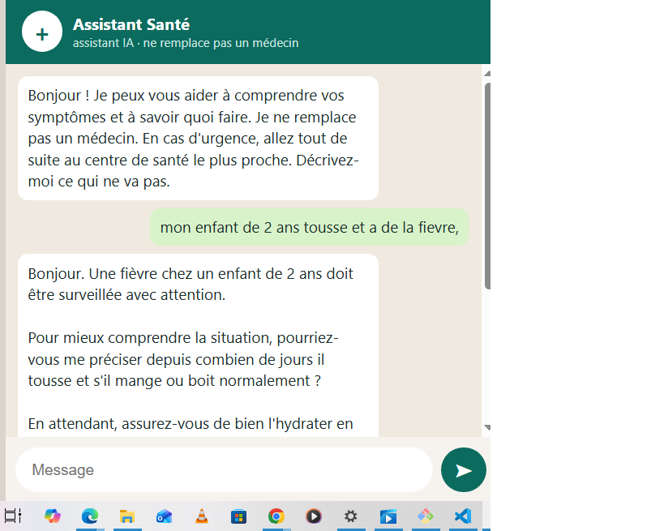

# Boussole Santé Togo – IA d'orientation en santé

Assistant conversationnel qui aide les personnes au Togo à comprendre leurs symptômes et à savoir quoi faire ensuite : soins à la maison, consultation ou urgence. Il est pensé pour WhatsApp, et une version de test fonctionne déjà dans le navigateur.

> ⚠️ Cet outil **n'est pas un médecin** : il oriente, il ne pose pas de diagnostic et ne prescrit pas de médicaments. En cas d'urgence, il faut se rendre immédiatement au centre de santé le plus proche.



## Le problème

Beaucoup de personnes n'ont pas un accès facile à une information de santé fiable et rapide. WhatsApp est utilisé tous les jours par une grande partie de la population : c'est là que l'aide doit se trouver.

## La solution

1. La personne décrit ses symptômes dans une discussion.
2. L'assistant pose quelques questions courtes si nécessaire.
3. Il donne une orientation claire : soins à la maison, consultation ou urgence.

## Règles de sécurité

- Pas de diagnostic certain, seulement une orientation.
- Détection des urgences (difficultés respiratoires, convulsions, saignements abondants, bébé qui ne réagit plus...) avec réponse immédiate.
- Aucune dose de médicament : renvoi vers un pharmacien ou un médecin.
- Refus poli des questions hors santé.

## Technologies

- Python
- API Gemini (Google) pour générer les réponses, avec plusieurs modèles de secours si le service est occupé
- Flask pour le serveur et l'interface de discussion dans le navigateur
- Réponses en continu (streaming) pour un affichage rapide

## État du projet

- [x] Maquettes de l'interface WhatsApp
- [x] Prototype en ligne de commande avec consignes de sécurité
- [x] Interface de discussion dans le navigateur
- [x] Tests des scénarios (cas normaux, urgences, refus de doses)
- [ ] Connexion à Telegram, puis à WhatsApp (API officielle de Meta)
- [ ] Relecture des consignes par un professionnel de santé
- [ ] Support de langues locales (éwé, kabiyè)

## Installation

```bash
git clone https://github.com/abdoulridwan2-commits/boussole-sante-togo.git
cd boussole-sante-togo
python -m venv venv
venv\Scripts\activate        # Mac/Linux : source venv/bin/activate
pip install -r requirements.txt
```

Crée un fichier `.env` à la racine avec ta clé gratuite d'Google AI Studio :

```
GEMINI_API_KEY=ta_clé_ici
```

## Lancement

Dans le terminal :

```bash
python main.py
```

Ou dans le navigateur :

```bash
python app.py
```

puis ouvre `http://127.0.0.1:5000`.

## Auteur

Abdoulaye Ridwan – étudiant en géographie, passionné de développement web et d'IA.
GitHub : [abdoulridwan2-commits](https://github.com/abdoulridwan2-commits)
